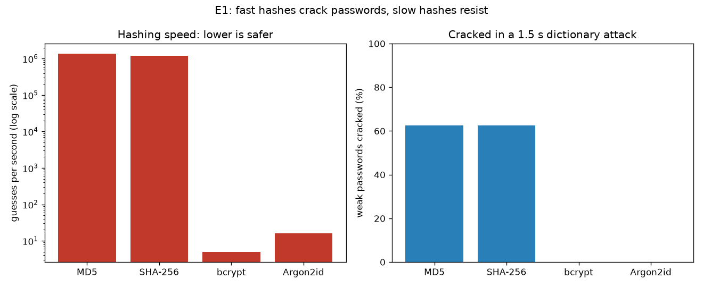
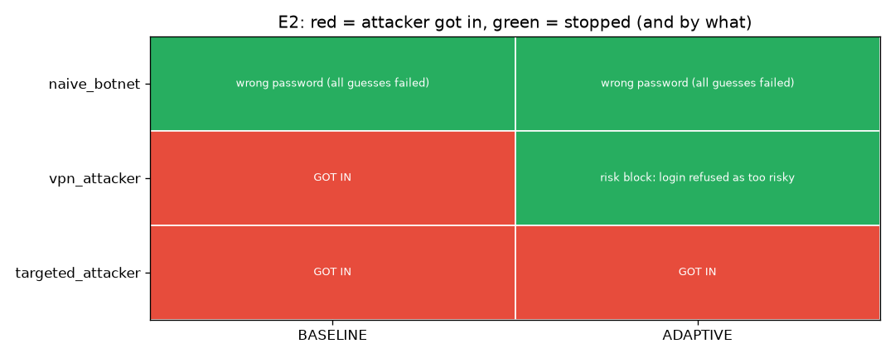
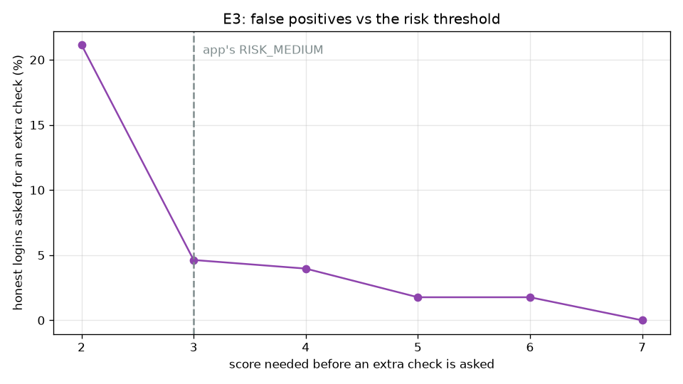
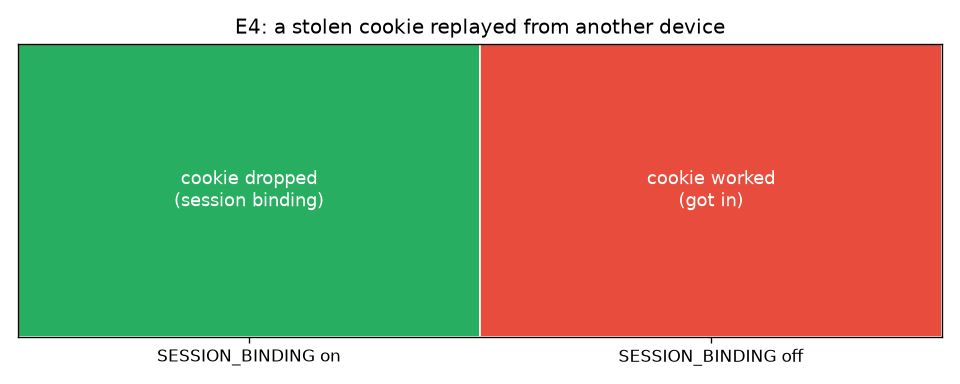
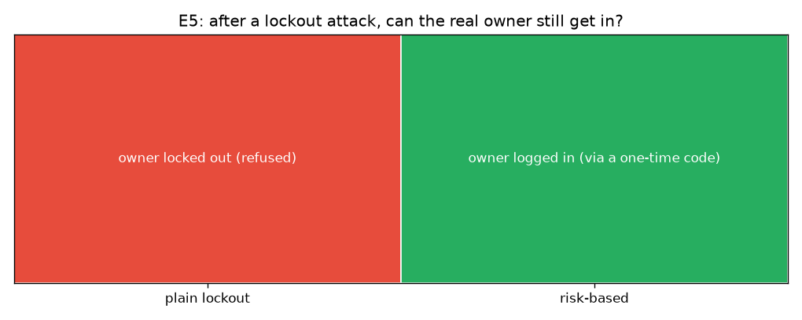
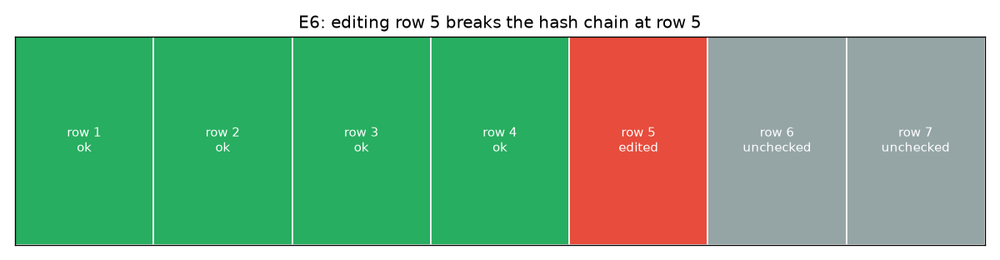
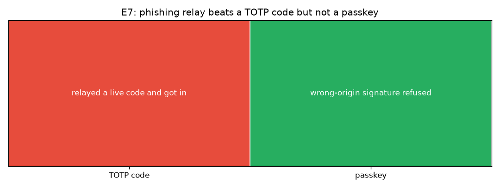

# Risk-Based Authentication

**Protecting accounts even after a password is stolen.**

CS2413 Information Security, University of New Brunswick, Fall 2026. Team 20.

## How to run

You only need Python 3.11 or newer. No Docker, no database setup, no config files.

```
git clone https://github.com/AaryanKapoor08/team20.git
cd team20
python run.py
```

On a Mac, use `python3 run.py`. Then open **http://localhost:8000** in your browser.

The first run installs everything and creates the demo accounts. Later runs just start the app.

### Demo logins

All four accounts use a public password (local testing only). Risk is judged from *how* a
login happens, not from the account, so every account logs in at **low risk** the first time
and goes straight in. The table shows what each account is set up to demonstrate.

| Email | Password | Role | What to try |
|---|---|---|---|
| `admin@example.com` | `admin-demo-pass` | admin | Log in, then open the **admin dashboard** at `/admin` (recent logins, blocked IPs, log status, charts). |
| `alice@example.com` | `alice-demo-pass` | user | Log in, then **set up an authenticator app** from the home page. A later unusual login asks for a 6-digit code (medium risk). |
| `bob@example.com` | `bob-demo-pass` | user | Log in, then **add a passkey** from the home page. A later very unusual login requires it (high risk). |
| `carol@example.com` | `carol-demo-pass` | user | A plain **low-risk** login: straight in, no extra step. |

**Seeing the extra steps.** On a fresh install every request looks local, so logins stay low
risk. To make a login look unusual (different country, network or browser) start the app in lab
mode and run the attack scripts, which fake that context safely on localhost:

```
python run.py --lab
```

See **section C** below. Experiments E2 and E7 walk through the medium (code) and high (passkey)
cases end to end.

## The problem

Passwords get stolen all the time: fake login pages, malware on someone's laptop, and leaked
databases. Once an attacker has the right password, a normal login page cannot tell them apart
from the real user.

This project asks: **can we still protect an account after its password is stolen?**

## What the app does

Every login is checked for more than just the password. The app looks at *how* the login is
happening: where it comes from, what browser and device it uses, and whether lots of failed
logins are happening at the same time. It gives each login a risk level:

| Risk | What happens |
|---|---|
| Low (looks like the usual user) | Logs in normally |
| Medium (something is unusual) | Must also enter a 6-digit code from an authenticator app |
| High (very unusual) | Must use a passkey (fingerprint, face or device PIN), or is blocked |

Other protections:

- **Safe password storage.** Passwords are scrambled with Argon2id (slow and one-way), plus a
  secret key (the "pepper") kept outside the database. A stolen database alone is not enough to
  recover them.
- **Encrypted app codes.** The secrets behind the 6-digit codes are stored encrypted (AES-GCM).
- **Logins tied to the device.** If someone copies a logged-in user's cookie to another computer,
  the session is ended.
- **A log that can't be secretly edited.** Every security event is recorded, and each entry is
  linked to the one before it, so changing any entry is detected.
- **Admin dashboard.** Shows recent logins, why each one got its risk level, blocked addresses,
  and whether the log is intact.
- **Firewall rules.** Addresses that behave like attackers get blocked, and the admin page only
  opens from allowed addresses.

The app runs in one of two profiles. `python run.py` uses **ADAPTIVE** (everything above).
`python run.py --baseline` uses **BASELINE** (password + rate limit + lockout only, like most
sites), which the experiments compare against.

## Tech stack

| Tool | What we use it for |
|---|---|
| Python + Flask | The web app |
| SQLite | The database (a single file, built into Python) |
| Plain HTML and CSS | The web pages |
| Argon2 | Storing passwords safely |
| cryptography (AES) | Encrypting the secrets behind the 6-digit codes |
| pyotp + qrcode | 6-digit authenticator codes and the QR code to set them up |
| webauthn | Passkeys |
| Chart.js | Charts on the admin dashboard |
| pytest | Automated tests |
| matplotlib | Charts for the experiment results |
| hashcat | Password-cracking tool, used only in one experiment (optional) |
| Nginx + Docker | Optional second way to run the app, with an extra firewall in front |

Everything installs with Python's normal package installer (or `uv`) and works the same on
Windows and Mac.

---

# Section A: Implementation (`app/`, `nginx/`)

The web app lives in `app/`. One file does one job.

| File | What it does |
|---|---|
| `run.py` | One command to set up and start the app. Checks Python, makes the virtual environment, installs packages, starts Flask on `localhost:8000`. |
| `app/routes.py` | Builds the Flask app. The login, logout and home pages. Keeps the routes thin. |
| `app/step_up_routes.py` | The authenticator-app and passkey setup and verify pages. |
| `app/admin_routes.py` | The admin dashboard, the unblock-IP action, and the experiment charts. |
| `app/dashboard.py` | Reads the lists and counts the admin dashboard shows. |
| `app/config.py` | Settings, the security profile, and loading or making `keys.json`. |
| `app/db.py` | The database connection, the tables, and the demo users. |
| `app/passwords.py` | Hashing and checking passwords (Argon2id + pepper). |
| `app/client_context.py` | Works out the IP, country, network and browser of a request (and reads the lab header). |
| `app/risk.py` | Gives a login a risk score, a level and the reasons. |
| `app/limits.py` | Per-IP rate limit and account lockout (the BASELINE defense). |
| `app/totp.py` | Authenticator-app codes and the AES-encrypted secrets. |
| `app/passkeys.py` | Passkey (WebAuthn) register and login. |
| `app/sessions.py` | Device-bound login sessions. |
| `app/audit_log.py` | The hash-chained security log and the chain check. |
| `app/firewall.py` | The IP blocklist and the admin-IP allowlist, inside Flask. |
| `app/csrf.py` | A CSRF token for every form. |
| `app/templates/`, `app/static/` | The HTML pages and the local JS files (passkey helper, Chart.js). |
| `nginx/` | Optional Nginx firewall config, used only with Docker. |

Security choices worth calling out:

- The **pepper, AES key and Flask secret key** are made on first run and saved to `keys.json`,
  which is never committed. A leaked database alone cannot undo the hashing or decrypt the codes.
- SQL always uses `?` placeholders, never string building.
- A wrong email and a wrong password show the **same** message, and a wrong email still runs a
  full password check, so timing does not leak which emails exist.
- Only the **hash** of a session token is stored, so a database leak gives no live sessions.
- Session cookies are `HttpOnly` and `SameSite=Lax`.

---

# Section B: Experimental setup

All experiments were run on one machine. Numbers in section D are from this setup.

**Machine**

- Laptop: Windows 11 Home (build 10.0.26300)
- CPU: AMD Ryzen 7 8845HS (8 cores / 16 threads)
- GPU: NVIDIA GeForce RTX 4050 Laptop (not used; only needed for the optional hashcat run in E1)
- Python: 3.11.15 (the project's `.venv`)

**Package versions (relevant to the experiments)**

- flask 3.1.3
- argon2-cffi 25.1.0 (Argon2id)
- cryptography 50.0.2
- bcrypt 5.0.0
- pyotp 2.10.0
- matplotlib 3.11.2

**Password-hashing settings (used by the app and measured in E1)**

- Argon2id: library defaults — time cost 3, memory 64 MiB, parallelism 4
- bcrypt: cost factor 12
- MD5, SHA-256: plain single-pass hashes (the weak baseline)

**Risk thresholds (used by the app and varied in E3)**

- Medium at score 3, high at 7, IP-block at 12 (see `app/config.py`).

**Sample sizes**

- E1: an 8-target hash set (5 weak + 3 strong) against a 4000-entry stand-in wordlist, 1.5 s
  crack budget per target; speed measured over a 2 s run per algorithm.
- E3: 1000 generated users, 12 history logins and 6 test logins each = 6000 honest logins scored,
  against a fixed background of 1000 common logins. Fixed random seed, so the result repeats.

**Two notes on what is not in the repo (and why the experiments still run anywhere):**

- **hashcat (E1):** not installed on the build machine. E1 instead runs a reproducible pure-Python
  dictionary attack that makes the same point; the script auto-uses hashcat if it is ever on PATH.
- **Real login dataset (E3):** the public RBA dataset (Wiefling et al., CC BY 4.0) is ~15 GB and is
  not downloaded or committed. E3 instead replays a generated population of honest users (stable
  home device and network, with occasional honest changes) through the real risk engine. It models
  the same false-positive question and runs on any machine.

Wordlists and datasets, if ever added, go in `wordlists/` and `data/`, which are both gitignored.

---

# Section C: Experiments (`attacks/`, `experiments/`)

## The attackers (`attacks/`)

Five scripts attack our own app the way real attackers would. Each prints one clear result: got
in or not, and which defense stopped it. They refuse to run against anything but localhost.

| Attacker | What they know and try |
|---|---|
| `naive_botnet.py` | Leaked passwords from many fake IPs and countries, a few tries per IP. |
| `vpn_attacker.py` | The right password and the victim's country, but a different network and browser. |
| `targeted_attacker.py` | Copies the victim's country, network and browser, and enters a phished 6-digit code. |
| `infostealer.py` | The victim's password plus a copied login cookie, used from another context. |
| `lockout_abuser.py` | Fails logins on purpose against real accounts to try to lock them out. |

To run the attackers, start the app in lab mode (lab mode is what lets the scripts fake their
context, and it is ignored when off), then run a script in a second terminal:

```
python run.py --lab
python attacks/vpn_attacker.py
```

## The experiments (`experiments/`)

One command runs all seven and redraws every chart into `results/`:

```
python experiments/run_experiments.py
```

Each experiment can also be run on its own (for example `python experiments/e3_false_positives.py`).
E2–E7 start the app themselves on a fresh temporary database, so they need no running server and
leave no state behind. E1 is skipped with a message if hashcat is missing, keeping the committed
Python-based E1 results.

| # | Question |
|---|---|
| E1 | How fast can stolen password databases be cracked with different storage methods? |
| E2 | Which attackers get in, and which protection stops each one (BASELINE vs ADAPTIVE)? |
| E3 | How often would real users be asked for an extra check by mistake? |
| E4 | Does tying logins to the device stop a stolen cookie? |
| E5 | Can an attacker lock real users out, and does the risk check help? |
| E6 | Is editing the security log detected? |
| E7 | Do passkeys stop an attacker who tricked the user into giving up a code? |

---

# Section D: Results

The CSV data and the charts below are in `results/`. All numbers are from the machine in
section B and are reproducible: the experiments use fixed inputs and were rerun from a clean
start with matching results.

## E1 — Slow hashes resist cracking



Guessing speed on this machine: **MD5 ~1.38 million/s, SHA-256 ~1.19 million/s, bcrypt ~5/s,
Argon2id ~16/s.** In the crack budget, MD5 and SHA-256 recover every weak password; bcrypt and
Argon2id recover none. A fast hash lets an attacker try millions of guesses a second against a
stolen database; Argon2id (what the app uses) makes that roughly a hundred thousand times slower.

## E2 — Which attacker gets in, and what stops it



| Attacker | BASELINE | ADAPTIVE |
|---|---|---|
| naive_botnet | blocked (wrong passwords) | blocked (wrong passwords) |
| vpn_attacker | **gets in** | **blocked by the risk check** |
| targeted_attacker | **gets in** | **gets in** |

The VPN attacker has the right password and only a BASELINE site lets it in; the risk check stops
it. The targeted attacker copies the victim's whole context, so the risk check sees a normal login
and it gets in under both — the case only a passkey stops (see E7).

## E3 — The cost to real users



Share of honest logins asked for an extra check, by threshold:

| Threshold | Flagged |
|---|---|
| 2 | 21.2% |
| **3 (the app's setting)** | **4.6%** |
| 4 | 4.0% |
| 5 | 1.8% |
| 7 | 0.0% |

Lower threshold = more attackers caught, but more real users nagged. At the app's setting (3),
about 1 in 20 honest logins gets a second step.

## E4 — Device-bound sessions



With session binding **on**, a stolen cookie replayed from another device is refused. With it
**off**, the same cookie works. Binding a session to the browser, OS and network it was made on
stops a copied cookie.

## E5 — Lockout abuse



With plain lockout, an attacker who floods wrong passwords locks the real owner out (a
denial-of-service). With risk-based handling, the owner is not hard-locked and still gets in via a
one-time code, because the burst of failures raised the login's risk instead of freezing the
account.

## E6 — Tamper-evident log



A clean 7-row chain verifies with no break. After one row (row 5) is edited directly with SQL, the
chain check reports the break at exactly row 5. Each entry is hashed together with the entry before
it, so a silent edit cannot go unnoticed.

## E7 — Passkeys beat phishing



A phished 6-digit code **works** for the attacker: codes can be relayed to the real site in time. A
passkey signature made for a look-alike phishing origin is **refused**: a passkey only signs for the
real site's address, so it cannot be phished.

## Limitations

- **Context cloning.** An attacker who copies the victim's full context (country, network, browser)
  looks like a normal login to the risk check (E2, targeted attacker). The answer is a passkey (E7),
  not a smarter score.
- **Phishable codes.** 6-digit authenticator codes can be relayed by a live phishing site (E7). They
  still raise the bar for medium-risk logins; passkeys are the phishing-proof step for high risk.
- **Deleting the newest log rows.** The hash chain detects edits to existing rows (E6) but does not
  by itself prove that the most recent rows were not simply dropped.
- **Synthetic E1/E3 inputs.** E1 uses a pure-Python crack (no GPU hashcat) and E3 uses a generated
  honest-user population rather than the full public dataset; both model the same question and are
  fully reproducible, but the absolute numbers would shift on other hardware or real traffic.

---

## Optional: running with Docker and Nginx

A second way to run the app puts Nginx in front of Flask as an extra firewall. Only Nginx's port
is published; Flask cannot be reached directly.

```
docker compose up
```

Open http://localhost:8000 as before. This is optional — plain `python run.py` is the main path.

## Ground rules

All attacks run only against our own app on our own computers. No real users, no real websites.
